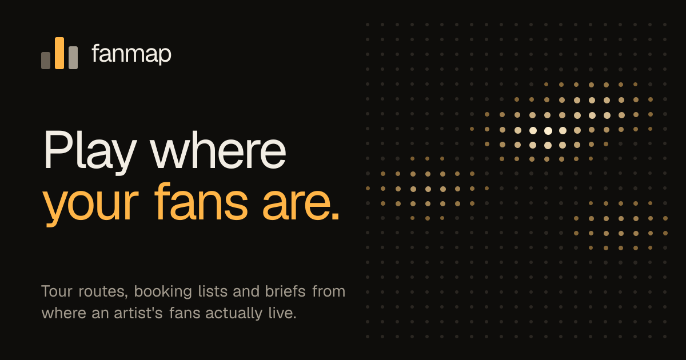
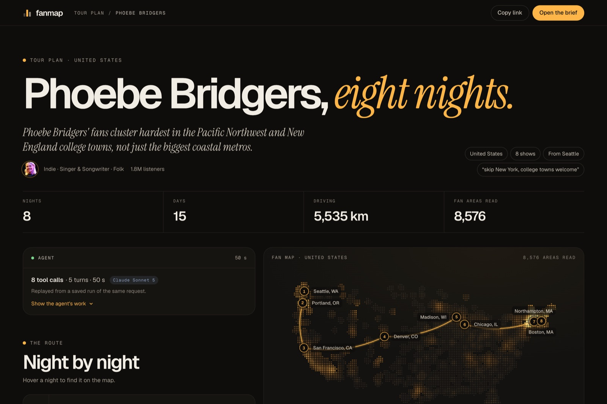
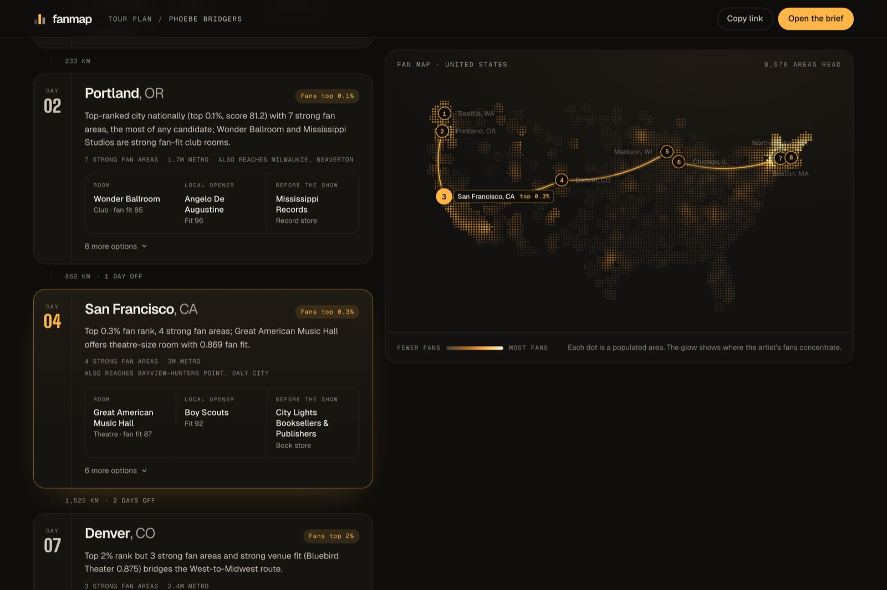
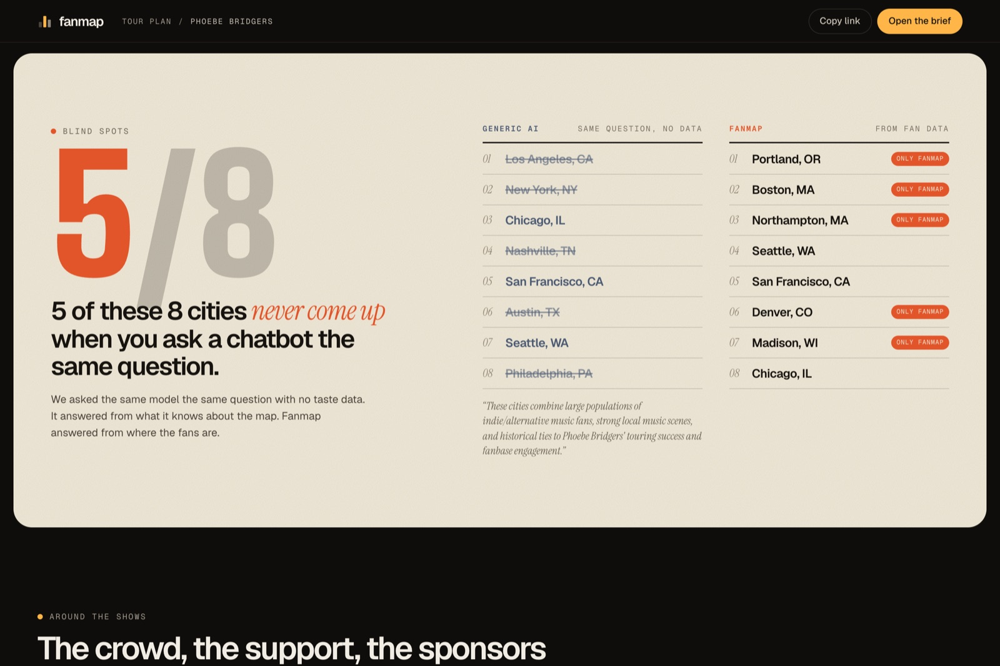
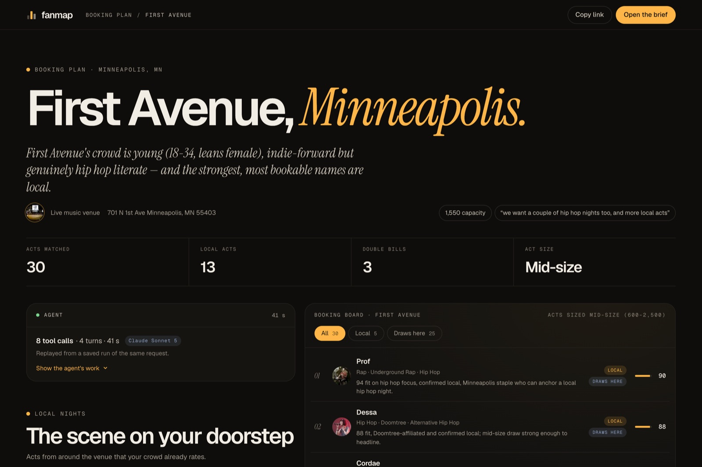
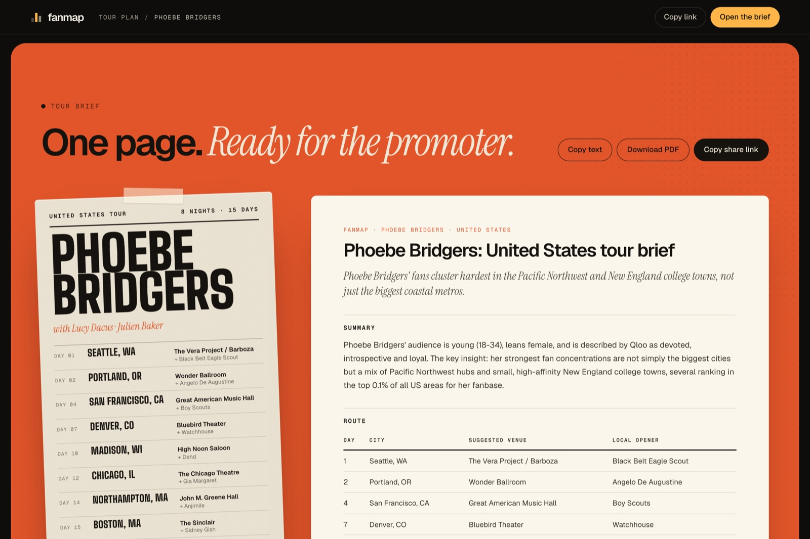

# Fanmap — Play Where Your Fans Are

> An AI agent that plans **tours** and **bookings** from where an artist's fans actually
> are. **Qloo**'s taste graph maps fan concentration across thousands of areas in a
> country, a **Claude** agent turns it into a route, a room and a local opener for every
> night, the crowd and the sponsors to pitch, and every plan is checked against what the
> same model answers **without** the data.

Built for the **[Qloo Agentic Hackathon](https://qloo.devpost.com/)**.

---

## Live

- 🎥 **Demo video** — https://youtu.be/7sHSdtoshfM
- 🌐 **Live app** — https://www.fanmap.xyz (no login)
- 🗺️ **A real tour plan, replayed** — https://www.fanmap.xyz/plan?example=phoebe-us
- 🎟️ **A real booking plan for a venue** — https://www.fanmap.xyz/plan?example=first-avenue
- ✍️ **Plan your own** — https://www.fanmap.xyz/plan (any artist, any country, about a minute)

---

## Table of Contents

- [Quick Path](#quick-path)
- [Why It Stands Out](#why-it-stands-out)
- [What it does](#what-it-does)
- [How it works](#how-it-works)
- [Requirements](#requirements)
- [Setup](#setup)
- [Usage](#usage)
- [API](#api)
- [Deploying](#deploying)
- [Data and credits](#data-and-credits)
- [Project layout](#project-layout)
- [AI assistance](#ai-assistance)
- [License](#license)

---

## Quick Path

If you want the shortest path through the project:

```bash
npm install
cp .env.example .env     # add QLOO_API_KEY and ANTHROPIC_API_KEY
npm test                 # 30 unit tests, made-up data only
npm run dev              # http://localhost:3000
```

For the fastest look without installing anything, open a saved run. It replays the
agent's real steps, then the finished plan:

- Phoebe Bridgers, 8 US nights — https://www.fanmap.xyz/plan?example=phoebe-us
- First Avenue, Minneapolis — https://www.fanmap.xyz/plan?example=first-avenue
- Burna Boy, UK arenas — https://www.fanmap.xyz/plan?example=burna-uk

## Why It Stands Out

Ask any AI where an indie artist should tour and you get a population map: New York,
Los Angeles, Chicago, Austin, Nashville. Fans don't live by city size. Fanmap does three
things together:

- **It reads taste, not population.** Qloo heatmaps score every area of a country for how
  strongly it leans toward the artist (8,576 areas for Phoebe Bridgers in the US). Fanmap
  clusters them into real metros and ranks each against the whole country ("top 0.1%").
- **It turns the data into decisions.** A Claude agent chains 7–9 tools over that data:
  it picks the cities, routes the nights, finds a room sized to the act and a local opener
  in each city, reads the crowd and the brands it loves, and writes a brief a promoter can
  use. It follows plain-English wishes ("skip New York", "end in Oklahoma", "more hip hop
  nights").
- **It proves the difference on every run.** The same model answers the same question with
  no data, and Fanmap shows where they differ: **5 of 8** cities for Phoebe Bridgers
  (Portland OR, Boston, Northampton MA, Denver, Madison) and **10 of 10** booking picks for
  First Avenue never appear in the generic answer.

```text
artist + country → Qloo heatmap (thousands of areas) → metro clusters → ranked cities
   → agent: scout rooms + local openers · audience · brands · route → plan + brief
   → compared with the same model, no data
```

## What it does

- **Artist mode — "Where should I tour?"** Cities ranked by fan strength, in driving order,
  with a room (and backups) for each night, a local opener from that scene, a place fans
  like before or after the show, support acts who share the fans, the crowd profile, and
  sponsors with a pitch.
- **Venue mode — "Who should I book?"** The acts a venue's crowd loves, sized to the room,
  with Local and Draws-here filters, the local scene for support slots, and double bills
  with shared taste behind them.
- **The blind-spots comparison** — every plan, city by city or act by act, against the same
  model's answer without Qloo data.
- **A live agent** — every tool call and the agent's notes stream to the browser as they
  happen, while a dot map of the country fills with fan heat and the route draws itself.
  The map works for any country, built from an offline GeoNames index.
- **One-page brief** — a gig poster and the written brief, with copy, print-to-PDF and a
  share link that replays the same plan.
- **Honest by design** — results say where fans' *taste* is concentrated, never promise
  ticket sales, flag thin data, and leave out acts Qloo describes as gone (late artists,
  split-up bands). Only aggregated, anonymous taste data is used.

## How it works

```text
Browser ──POST /api/plan──▶ plan cache? ──yes──▶ replay recorded steps + plan
                                  │no
                                  ▼
                     Claude agent (tool loop)  ──fails──▶ data pipeline (no LLM)
                                  │ tools
                                  ▼
                Fanmap engine (Qloo + offline world city index)
   fan map → metro clusters → ranked cities · venues · local acts · route · audience · brands
```

- **Qloo calls used:** search (artists, places), Insights for artists, places, brands and
  demographics, heatmaps (fan concentration by area), `filter.results.entities` (scoring a
  fixed shortlist) and compare (shared taste for double bills).
- **Agent tools (artist):** `find_artist`, `map_fans`, `get_audience`, `find_support_acts`,
  `find_brands`, `scout_cities`, `compare_artists`, `plan_route`, `submit_plan`.
  **Venue:** `find_venue`, `find_acts`, `find_local_acts`, `get_crowd`, `find_brands`,
  `build_double_bills`, `submit_booking_plan`. A typical run is 7–8 tool calls in 35–60 s.
- **Streaming:** the route handler streams newline-delimited JSON (steps, the agent's notes,
  partial results), so the map, route and booking board build while the agent works.
- **Without Qloo:** the same model gets the same question with no tools; answers are
  compared by distance (cities) or by name (acts).
- **Resilience:** identical requests replay from a plan cache (Upstash Redis in
  production); if Claude is unavailable, a deterministic data pipeline still returns the
  plan; visitors are rate-limited and agent runs have a daily budget.

| A plan building live | Night by night, linked to the map |
|---|---|
|  |  |

| Blind spots | Venue mode |
|---|---|
|  |  |

| The brief |
|---|
|  |

## Requirements

- macOS or Linux
- Node.js 20+ and npm
- A Qloo API key (the hackathon key)
- Optional: an Anthropic API key for the agent and the comparison (without it, plans come
  from the data pipeline)
- Optional: an Upstash Redis database for a shared cache and rate limits in production

## Setup

### 1. Install

```bash
git clone https://github.com/Pavilion-devs/fanmap.git
cd fanmap
npm install
```

### 2. Configure the environment

```bash
cp .env.example .env
```

```dotenv
QLOO_API_KEY=your_hackathon_key_here
QLOO_BASE_URL=https://hackathon.api.qloo.com
ANTHROPIC_API_KEY=sk-ant-...
ANTHROPIC_MODEL=claude-sonnet-5          # optional; default claude-opus-5-5

# production: shared cache, plan cache and rate limits
# (Vercel's Upstash integration sets KV_REST_API_URL / KV_REST_API_TOKEN instead; either works)
UPSTASH_REDIS_REST_URL=
UPSTASH_REDIS_REST_TOKEN=

# optional limits
FANMAP_FRESH_PLANS_PER_HOUR=6
FANMAP_CACHED_PLANS_PER_HOUR=60
FANMAP_AGENT_RUNS_PER_DAY=300
```

### 3. Run the checks

```bash
npm test             # 30 unit tests (made-up data; Qloo responses are never stored in the repo)
npm run lint
npm run typecheck
```

### 4. Start the app

```bash
npm run dev          # http://localhost:3000
```

## Usage

```bash
# The app
npm run dev

# The engine from the terminal
npm run cities -- "Phoebe Bridgers|United States"                                       # ranked cities only
npm run plan -- "Zach Bryan" --shows=8 --size=club                                       # artist mode, data pipeline
npm run agent -- "Phoebe Bridgers" --shows=8 --start="Seattle" --notes="skip New York"   # artist mode, full agent
npm run venue -- "First Avenue, Minneapolis" --capacity=1550                             # venue mode, data pipeline
npm run venue-agent -- "Cain's Ballroom, Tulsa" --capacity=1700                          # venue mode, full agent

# The one-click examples
npm run warm                     # pre-run the examples into the plan cache
npm run upload-plans -- --days=30   # copy locally saved plans into Upstash with a fresh expiry
```

## API

`POST /api/plan` streams newline-delimited JSON events (types in
[`src/lib/types.ts`](src/lib/types.ts)):

```jsonc
// artist mode
{ "mode": "artist", "artist": "Phoebe Bridgers", "region": "United States", "shows": 8,
  "venueSize": "club|theatre|arena|any", "startCity": "Seattle", "notes": "skip New York" }
// venue mode
{ "mode": "venue", "venue": "First Avenue, Minneapolis", "capacity": 1550, "genres": ["indie"], "notes": "..." }
```

Events: `step` (a tool call starting or finishing), `thought` (the agent's notes),
`partial` (a piece of the plan is ready), `notice`, then `result` or `error`. Identical
requests replay from the plan cache with the same steps. Visitors are rate-limited
(HTTP 429 with `Retry-After`).

## Deploying

The live app runs on Vercel with Upstash Redis:

1. Import the repo in Vercel (Next.js preset) and add the environment variables above.
2. Create an Upstash Redis database and add its REST URL and token.
3. Copy saved example plans into it so they replay instantly:
   `npm run upload-plans -- --days=30` (needs the Upstash values in your local `.env`).

## Data and credits

- **Taste data:** [Qloo](https://www.qloo.com) Insights API. Responses are cached privately
  on the server and are never stored in this repo.
- **City data:** [GeoNames](https://www.geonames.org) `cities15000`, licensed
  [CC BY 4.0](https://creativecommons.org/licenses/by/4.0/). Rebuild with
  `npm run build:cities` after downloading the files listed in `scripts/build-cities.mjs`
  into `data-raw/`.
- **Photography:** [Unsplash](https://unsplash.com) (Unsplash licence).
- **AI:** [Claude](https://www.anthropic.com) by Anthropic.

Fan scores show where taste is concentrated, not guaranteed ticket sales.

## Project layout

```text
fanmap/
├── src/
│   ├── app/
│   │   ├── page.tsx              landing page
│   │   ├── plan/                 start page and live results page (/plan)
│   │   ├── api/plan/             streaming API route
│   │   └── opengraph-image.tsx   share image
│   ├── components/
│   │   ├── landing/              hero 3D fan map, blind spots, how it works, venue mode, brief
│   │   └── plan/                 agent log, 2D fan map, night cards, comparison, insights,
│   │                             venue board, poster + brief, streaming hook
│   ├── lib/
│   │   ├── agent/                Claude agent loop, artist and venue agents, comparison, briefs
│   │   ├── engine/               city ranking, venues, local acts, route, venue picks
│   │   ├── qloo/                 Qloo API client (server-only, cached, paged, rate-limited)
│   │   ├── geo/                  offline world city index, country dot basemap
│   │   ├── runPlan.ts            plan cache + replay, daily agent budget
│   │   ├── plan.ts               agent or pipeline, baseline comparison, input validation
│   │   ├── cache.ts              memory / file / Upstash cache and counters
│   │   └── limits.ts             per-visitor rate limits
│   └── data/cities.json          GeoNames city index (CC BY 4.0)
├── scripts/                      engine CLIs, warm-up and plan upload
├── tests/                        unit tests (made-up data)
├── docs/assets/                  README images
└── plan.md                       original plan and judging notes
```

## AI assistance

Fanmap was designed and implemented with **Claude Code** (Claude Opus 5.5), including the
engine, the agent, the web app, deployment and documentation. At runtime, **Claude**
(via the Anthropic API; the live site uses `claude-sonnet-5`) runs the planning agent and
writes the briefs, and the same model answers without data for the comparison. Every city,
venue, act and number in a plan comes from Qloo data through the engine; the agent can only
choose among what the data produced. This disclosure is retained explicitly for the
hackathon rules.

## License

MIT — see [`LICENSE`](LICENSE).
